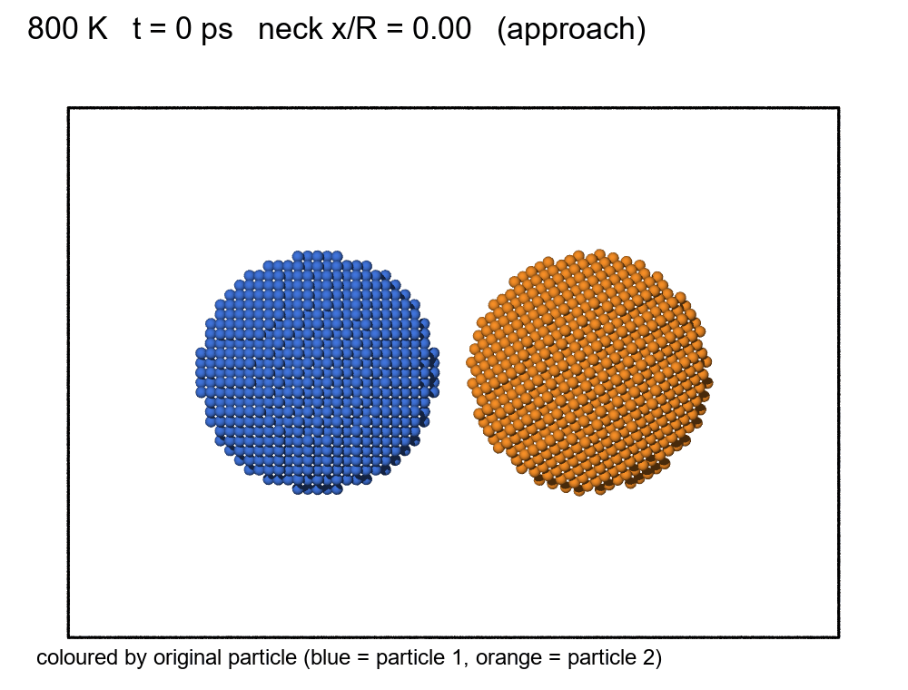
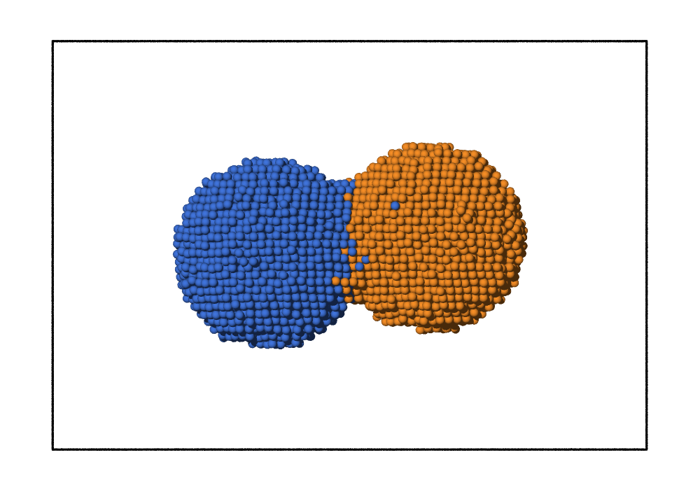
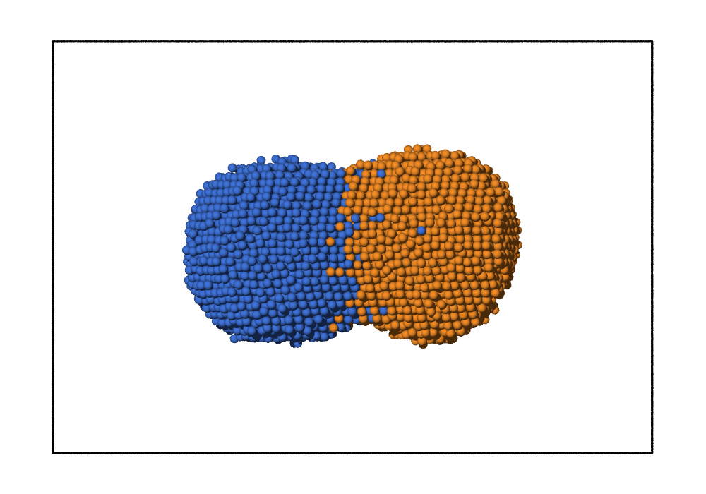

# Sintering of Two Aluminium Nanoparticles

Molecular dynamics of two Al nanoparticles (R = 2.5 nm) coalescing at 700 K and 800 K.
**MT41028 Atomistic Modelling of Materials, Project 7 · Group 5.** Tools: Atomsk · LAMMPS · OVITO.



**Question:** how does temperature affect the coalescence of two nanoparticles?
**Answer in one line:** both temperatures form the neck equally fast (≈ 11 ps to bonded contact), but at 700 K the neck stalls at x/R ≈ 0.69 while at 800 K it keeps growing to x/R ≈ 0.85.

## Contents

1. [Key results](#1-key-results)
2. [Model and simulation settings](#2-model-and-simulation-settings)
3. [Repository layout](#3-repository-layout)
4. [How to run](#4-how-to-run)
5. [Definitions of the measured quantities](#5-definitions-of-the-measured-quantities)
6. [Visualisation in OVITO](#6-visualisation-in-ovito)
7. [Physics notes](#7-physics-notes)
8. [Limitations and open points](#8-limitations-and-open-points)
9. [Further documents](#9-further-documents)
10. [References](#10-references)

---

## 1. Key results

0.5 ns production runs, one run per temperature.

| | 700 K | 800 K |
| :--- | :--- | :--- |
| First atom at the mid-plane (slab criterion) | 10 ps | 8 ps |
| First mid-plane contact | 10 ps | 8 ps |
| First bonded contact (atom pair < 3.4 Å) | 11 ps | 11 ps |
| Neck formed, x/R ≥ 0.3 (slab estimate) | 15 ps | 13 ps |
| Neck x/R at 500 ps | 0.69 (plateau after ≈ 20 ps) | 0.85 (still growing to ≈ 350 ps) |
| Rg at 500 ps (34.3 Å apart → 24.4 Å as one sphere) | 29.5 Å (≈ 48 % of the way) | 28.1 Å (≈ 62 %) |
| Potential energy released | ≈ 113 eV | ≈ 150 eV |
| Misorientation falls to ≈ 1° | ≈ 40–50 ps | ≈ 175–200 ps |
| Final shape | dumbbell | shorter, rounder, thicker neck |
| fcc fraction (OVITO CNA) | 0.65 | 0.59 |

- **Robust result:** the late-stage difference. 700 K stalls at x/R ≈ 0.68 for 480 ps, while 800 K keeps growing. This shows up in x/R, Rg and the energy.
- **Not significant:** the 1–2 ps differences in contact and neck times. They are within the noise of single runs and depend on the definition used.
- **No melting:** the fcc fraction stays at 0.5–0.65 at both temperatures.

| 700 K | 800 K |
| :---: | :---: |
|  |  |

Animations are in `images/gifs/`. The `*_fluent*.gif` files have 20 frames, dense in the first 20 ps; `*_particles.gif` shows only the particle-coloured view.

---

## 2. Model and simulation settings

| Item | Value |
| :--- | :--- |
| Material | Al, fcc, a₀ = 4.05 Å |
| Particles | Two spheres, R = 25 Å, 3,997 atoms each, **7,994 atoms** in total |
| Orientation | Particle 2 rotated **30° about z** (grain boundary in the neck) |
| Gap | 6.5 Å between ideal spheres; **7.6 Å between the closest atoms**, larger than the 6.29 Å cutoff, so contact needs thermal motion |
| Box | 160 × 110 × 110 Å, periodic, ≥ 25 Å vacuum on every side |
| Potential | EAM, **Mishin, Farkas, Mehl, Papaconstantopoulos, PRB 59, 3393 (1999)**; file `Al99.eam.alloy` from the NIST Interatomic Potentials Repository, unmodified |
| Units / ensemble | `metal`, NVT, Nosé–Hoover (damping 0.1 ps) |
| Time step / length | 1 fs, 500,000 steps = 500 ps |
| Start | CG minimisation, then `velocity create T 12345 mom yes rot yes` (same seed for both runs) |
| Output | thermo and trajectory every 1 ps (501 frames) |
| Measured mean T | 700.3 ± 6.2 K and 800.1 ± 6.3 K |

The reasons behind each choice are in [PROJECT_EXPLAINED.md](PROJECT_EXPLAINED.md).

---

## 3. Repository layout

```
build.sh   in.sinter   Al99.eam.alloy         inputs
structure/        Al_nanoparticles.lmp (+ Atomsk intermediates np1.xsf, np2.xsf)
output/700K/      log_700.lammps  traj_700.lammpstrj  final_700.data  neck_700.csv
output/800K/      same for 800 K
images/700K/      snap_700_<t>ps.png (particle colours), snap_700_<t>ps_cna.png (mid-plane slice, CNA)
images/800K/      same for 800 K
images/frames/    extra frames used for the fluent GIFs (0–20 ps every 1–2 ps, then 30–500 ps)
images/gifs/      sintering_<T>K.gif, sintering_<T>K_fluent.gif, sintering_<T>K_fluent_particles.gif
```

| Script | Purpose |
| :--- | :--- |
| `build.sh` | Atomsk: two R = 25 Å spheres, particle 2 rotated 30° about z, 160×110×110 Å box → `structure/` |
| `in.sinter` | LAMMPS: minimise → NVT at `T`; logs neck atoms (`v_nneck`) and radius of gyration (`c_rg`) → `output/<T>K/` |
| `analyze.py` | From the logs: contact time (slab), neck time (x/R ≥ 0.3), final x/R and Rg; writes `neck_<T>.csv` |
| `snapshots.py` | OVITO Python: renders snapshots. `SNAP_OUT=<folder>` redirects the output |
| `make_gifs.py` | 4-frame GIFs (particle view + CNA slice) |
| `make_gifs_fluent.py` | 20-frame GIFs, dense in the first 20 ps; also a particle-only version |
| `misorientation.py` | Misorientation of the two lattices about z vs time, from the trajectory |
| `check_contact_neck.py` | Bonded-contact frame and three independent neck-radius estimates |
| `check_potential.py` | Independent check of `Al99.eam.alloy`: a₀, E_coh, bulk modulus, unrelaxed surface energies |
| `cna_fcc_fraction.py` | fcc fraction from an adaptive CNA in pure Python (cross-check of OVITO) |
| `presentation_slides.md` | Slide-by-slide content for the talk |
| `PROJECT_EXPLAINED.md` | Every decision and calculation explained, with verification status of external facts |

The trajectories (`*.lammpstrj`, ≈ 120 MB each) are stored with **Git LFS**.

---

## 4. How to run

Commands are for a Mac/Linux shell; on Windows use `.venv\Scripts\python.exe` instead of `.venv/bin/python`.

```bash
./build.sh                                                     # Atomsk: 7,994 atoms → structure/
mpirun -np 6 lmp_mpi -log none -in in.sinter -var T 700       # -log none: no stray log.lammps
mpirun -np 6 lmp_mpi -log none -in in.sinter -var T 800
python3 analyze.py output/700K/log_700.lammps output/800K/log_800.lammps    # comparison table + CSVs
```

Post-processing:

```bash
.venv/bin/python snapshots.py 700 0 11 15 500                  # T, then times in ps → images/700K/
.venv/bin/python snapshots.py 800 0 11 13 500
.venv/bin/python make_gifs.py                                  # times are set inside the script

# fluent GIFs: render the 20 frames, then build
TIMES="0 2 4 6 8 9 10 11 12 13 14 15 16 18 20 30 50 100 200 500"
SNAP_OUT=images/frames/700K .venv/bin/python snapshots.py 700 $TIMES
SNAP_OUT=images/frames/800K .venv/bin/python snapshots.py 800 $TIMES
.venv/bin/python make_gifs_fluent.py

# checks (pure Python, no extra packages)
python3 misorientation.py 700 ; python3 misorientation.py 800
python3 check_contact_neck.py 700 ; python3 check_contact_neck.py 800
python3 check_potential.py Al99.eam.alloy
python3 cna_fcc_fraction.py 700 0 10 15 50 100 300 500
```

**Notes**
- **Quick test:** add `-var NSTEPS 20000` (20 ps, ≈ 1.5 min). Add `-var OUT <folder>` so test runs do not overwrite `output/`.
- **Run time:** one 6-core job ran at ≈ 20 ns/day (≈ 35 min per run). The two production runs, started together on 4 cores each, ran at only 1.8 ns/day (≈ 6.6 h each). Run them one after the other.
- **Python environment:** `.venv` (ignored by Git) holds `ovito` 3.17.2 and `pillow`, used by `snapshots.py` and the GIF scripts. The `check_*`, `misorientation.py` and `cna_fcc_fraction.py` scripts need only the standard library.
- **Fonts:** `make_gifs.py` uses a macOS font path; `make_gifs_fluent.py` looks for a Windows or macOS font automatically.

---

## 5. Definitions of the measured quantities

| Quantity | Definition |
| :--- | :--- |
| **First atom at mid-plane** | First output with an atom in the 4 Å slab centred on the centre of mass (`v_nneck` > 0). This is *not* bonded contact: the closest atoms are still ≈ 4.2 Å (700 K) and 4.7 Å (800 K) apart |
| **Bonded contact** | First frame with an atom of particle 1 and an atom of particle 2 closer than 3.4 Å (nearest-neighbour distance is 2.86 Å). Atom-level definition in the spirit of Hendy, Brown & Hyslop (2003). Measured by `check_contact_neck.py` |
| **Neck radius x** | x = √(N · V / (π · w)), N = atoms in the 4 Å mid-plane slab, V = a₀³/4 = 16.6 ų, w = 4 Å |
| **x/R** | x divided by the original radius R = 25 Å. Complete merging into one sphere would give x/R ≈ 1.26, so x/R = 0.85 is not "85 % done" |
| **Neck formed** | x/R ≥ 0.3, the classical end of the initial stage of sintering (X/D ≈ 0.3 in sintering textbooks). A geometric radius gives 13 / 12 ps instead of 15 / 13 ps |
| **Rg** | Radius of gyration of all atoms. 34.3 Å for two separate spheres, 24.4 Å for one sphere of equal volume |
| **Energy released** | Mean PE at 450–500 ps minus mean PE at 3–7 ps (before contact). Single-frame differences are uncertain by ≈ 10 eV |
| **Misorientation** | Angle between the in-plane ⟨110⟩ bond directions of the two particles (circular mean, period 90°), from `misorientation.py` |
| **fcc fraction** | OVITO common neighbour analysis (adaptive). Values from the OVITO session; `cna_fcc_fraction.py` gives 0.62 / 0.555 at 500 ps as a cross-check |

---

## 6. Visualisation in OVITO

1. Load `structure/Al_nanoparticles.lmp` first: two spheres, gap visible, nothing crossing the box edge.
2. Load `output/<T>K/traj_<T>.lammpstrj`, then add these modifiers:
   - **Compute property**: `PosX` = `Position.X`, then **Freeze property**: `PosX` at frame 0 → `InitialX` (freezing `Position.X` directly would copy the whole vector).
   - **Color coding** by `InitialX`: each particle gets its own colour, so you can see where the neck atoms come from.
   - **Common neighbor analysis**: fcc = green, other = white. Surfaces and the grain boundary appear white. An fcc fraction near 0 would mean melting.
   - **Slice** (optional): normal (0,0,1) through the centre, 5–6 Å thick, to show the neck cross-section.
3. Take snapshots at t = 0, at bonded contact (11 ps), at a clear neck (15 / 13 ps) and at the final frame. One frame = 1 ps.

---

## 7. Physics notes

1. **Why do the particles join?** Surface atoms have missing bonds and sit at higher energy. Merging removes surface area. The mean PE falls by ≈ 113 eV (700 K) and ≈ 150 eV (800 K) over the run; by the neck-formation frame it has fallen by only ≈ 60 eV (700 K) and ≈ 25 eV (800 K). A surface-energy estimate (≈ 1.05 J/m²) gives at most ≈ 213 eV for a full merge, so we reach about 53 % and 70 %.
2. **Why a neck?** The contact region is concave. By the Gibbs–Thomson relation its chemical potential is lower than on the convex surfaces, so atoms flow into it.
3. **Why does temperature speed it up?** Atom transport is thermally activated, D = D₀ exp(−Q/k_BT). The fast first stage (to x/R ≈ 0.6) is the same at both temperatures. Later growth needs surface diffusion over facets and is only active at 800 K.
4. **Where do the neck atoms come from?** Mainly from the surface atoms near the contact on **both** particles (two colours in the neck), plus local rearrangement at the new grain boundary.
5. **Why does it matter for nanoparticles?** Huge surface-to-volume ratio, tiny diffusion distances, and Herring's scaling (sintering time ∝ Rⁿ, n ≈ 4 for surface diffusion). Nanoparticles also melt below the bulk melting point.

**Grain boundary and rotation.** The 30° misorientation creates a grain boundary in the neck (white band in the CNA slices). The misorientation falls to about 1° by ≈ 40–50 ps at 700 K and ≈ 175–200 ps at 800 K, and the neck is fcc at both temperatures by 500 ps. **Caution:** the misorientation already drops from 30° to ≈ 20° *before* the particles touch. With no force across the 7.6 Å gap, that part is free thermal spin from the initial random velocities (`rot yes` removes only the *total* angular momentum, and both runs share the seed). Treat the alignment as an observation, not as proof of boundary-driven rotation (compare Zhu & Averback, 1996, for Cu).

---

## 8. Limitations and open points

- **One run per temperature** (seed 12345), so there are no error bars. The 1–2 ps differences in contact and neck time are within noise.
- **Two temperatures only**, so no activation energy can be extracted.
- **Gap larger than the cutoff** (7.6 Å vs 6.29 Å): the first-atom time depends on this choice. With a 4 Å gap, earlier tests gave contact in 1–4 ps at both temperatures with no temperature effect.
- **Rotation partly from initial velocities** (see Section 7). A repeat with other seeds, or with each particle's angular momentum zeroed separately, would test this.
- **500 ps** is too short for the 800 K neck, which is still growing.
- **Bulk-fitted EAM, small particles, no oxide shell, one 30° geometry.** The bulk melting point of this potential is 1041 K (experiment 933 K), so 700–800 K corresponds to 0.67–0.77 of the model's melting point.
- **NVT on the whole system** removes the released heat (≈ 55–70 K if it stayed in the particles).
- **Neck metric** is an estimate from a slab count. It matches the waist and a geometric radius to ≈ 0.03 in x/R after ≈ 17 ps, but underestimates a young neck.

---

## 9. Further documents

- [PROJECT_EXPLAINED.md](PROJECT_EXPLAINED.md): why each parameter was chosen, how every number is calculated, and the verification status of every external fact.
- [presentation_slides.md](presentation_slides.md): slide-by-slide content for the presentation.
- `project3.md`: the project handout. `course_project_presentation_guidelines.md`: presentation rules.

---

## 10. References

1. Y. Mishin, D. Farkas, M. J. Mehl, D. A. Papaconstantopoulos, *Phys. Rev. B* **59**, 3393 (1999). DOI 10.1103/PhysRevB.59.3393. File `Al99.eam.alloy`, [NIST Interatomic Potentials Repository](https://www.ctcms.nist.gov/potentials/entry/1999--Mishin-Y-Farkas-D-Mehl-M-J-Papaconstantopoulos-D-A--Al).
2. P. Hirel, *Comput. Phys. Commun.* **197**, 212–219 (2015) (Atomsk).
3. A. P. Thompson et al., *Comput. Phys. Commun.* **271**, 108171 (2022) (LAMMPS).
4. A. Stukowski, *Modelling Simul. Mater. Sci. Eng.* **18**, 015012 (2010) (OVITO).
5. J. Jiang, P. Chen, W. Sun, *J. Mater. Sci. Technol.* **57**, 92–100 (2020). DOI 10.1016/j.jmst.2020.03.068.
6. J. P. Liu et al., *Comput. Mater. Sci.* **190**, 110265 (2021). DOI 10.1016/j.commatsci.2020.110265.
7. H. Zhu and R. S. Averback, *Philos. Mag. Lett.* **73**, 27–33 (1996). DOI 10.1080/095008396181073.
8. L. J. Lewis, P. Jensen, J.-L. Barrat, *Phys. Rev. B* **56**, 2248–2257 (1997). DOI 10.1103/PhysRevB.56.2248.
9. S. C. Hendy, S. A. Brown, M. Hyslop, *Phys. Rev. B* **68**, 241403(R) (2003); [arXiv:cond-mat/0305481](https://arxiv.org/abs/cond-mat/0305481).
10. H. A. Alarifi et al., *Mater. Trans.* **54**, 884–889 (2013). DOI 10.2320/matertrans.MD201225.
11. D. Alimonti and F. Baletto, [arXiv:2412.16294](https://arxiv.org/abs/2412.16294) (bulk melting point of the Mishin Al EAM, Table 3).
12. C. Herring, *J. Appl. Phys.* **21**, 301–303 (1950). DOI 10.1063/1.1699658.
