# Presentation Content — Sintering of Two Al Nanoparticles

> **Course:** MT41028 Atomistic Modelling of Materials · **Date:** 07 Nov 2026 · **Format:** 10–12 min talk (hard stop 12 min) + 3–5 min Q&A
> **Submission:** PDF to portal by 17:00, 06 Nov 2026 as `Group##_MT41028_Project.pdf`
> **Slide plan:** 13 main slides (~11 min) + 4 backup slides. Image paths are relative to this file.
> Each slide has **On-slide content** (what goes on the slide) and **Speaker notes** (what to say; do not read the slide aloud). Suggested time is in each heading.
> Items in `[[ ... ]]` must be filled in by the group.

---

## Slide 1 — Title (0:20)

**On-slide content**

# Atomistic Simulation of the Sintering of Two Aluminium Nanoparticles
### How does temperature control coalescence? (MD at 700 K and 800 K)

| | |
|---|---|
| **Group** | [[Group ##]] |
| **Members** | [[Name 1 (Roll no.)]] · [[Name 2]] · [[Name 3]] · [[Name 4]] |
| **Course** | MT41028 Atomistic Modelling of Materials, Dept. of MME |
| **Instructor** | Prof. Sankha Mukherjee |
| **Tools** | Atomsk · LAMMPS · OVITO |

Hero image: `images/gifs/sintering_800K.gif` (embed as a still, `images/800K/snap_800_500ps.png`, in the PDF; the GIF is for a live demo only).

**Speaker notes:** Introduce the group and say who covers which part (see the speaker split at the end). One sentence on the question: *"We watched two 5 nm Al particles merge atom by atom and asked what temperature does to that."*

---

## Slide 2 — Motivation and Objective (0:50)

**On-slide content**

**Why sintering?**
- Core step in powder metallurgy, ceramics and additive manufacturing (laser/binder-jet powder-bed processes)
- At the atomic scale, the driver is **surface-energy reduction**: two surfaces become one grain boundary, or no boundary at all
- Nanoparticles have a huge surface-to-volume ratio, so they sinter far below bulk temperatures. That is useful for low-temperature processing and for nanoparticle inks, but it also means unwanted coarsening

**Central question:** *How does temperature affect the coalescence of two nanoparticles?*

**Process to observe**

> **DIAGRAM TO INCLUDE:** Horizontal 4-step flow with small sketches under each box: *Surface atoms move → Particles contact → Neck forms → Neck grows*. Sketch: two circles far apart, two circles touching, a dumbbell with a thin waist, a dumbbell with a thick waist.


**Objectives**
1. Build two equal Al spheres (R = 2.5 nm) with Atomsk
2. Run NVT MD at T₁ = 700 K and T₂ = 800 K (same everything else)
3. Quantify contact time, neck-formation time and neck growth; visualise in OVITO
4. Compare with published MD work

**Speaker notes:** Keep this to under a minute. Stress that the emphasis is on seeing a macroscopic process through individual atoms, plus a quantitative neck-growth metric.

---

## Slide 3 — System and Methodology (1/2): Model and Potential (1:30)

**On-slide content**

| Item | Value |
|---|---|
| Material | Aluminium, fcc, a₀ = 4.05 Å |
| Particles | Two spheres, **R = 25 Å (2.5 nm)**, ≈ 4000 atoms each, **7994 atoms** total |
| Orientation | Particle 1 = fcc [100] axes; particle 2 rotated **30° about z** (so a grain boundary forms at the neck) |
| Initial gap | 7.6 Å between closest atoms (centre-to-centre 56.5 Å). This is **beyond the 6.29 Å potential cutoff**, so contact needs thermal motion |
| Box | 160 × 110 × 110 Å, periodic, ≥ 25 Å vacuum on every side |
| **Potential** | **EAM, Mishin, Farkas, Mehl & Papaconstantopoulos, *Phys. Rev. B* 59, 3393 (1999)** |
| Parameter file | `Al99.eam.alloy`, from the NIST Interatomic Potentials Repository (LAMMPS `eam/alloy` conversion by C. A. Becker, 30 Dec 2008). It is a single-element file, **not** a merged or hand-edited one |
| Why this potential | Fitted to experimental data **and** ab initio (DFT) energies of alternative structures. Reproduces lattice constant, elastic constants, phonons, vacancy, stacking-fault and surface energies (per the paper's abstract). Surface energy is the quantity that drives sintering |
| Cutoff | 6.287 Å |

> **DIAGRAM TO INCLUDE:** Simulation-box schematic next to the OVITO image `images/700K/snap_700_0ps.png` (particle-coloured). Draw a rectangle (160 × 110 Å, periodic) with two equal circles (P1 blue, P2 orange) of radius R = 25 Å on the x-axis. Dimension arrows for: the 7.6 Å gap, R = 25 Å, the box length 160 Å, and ≥ 25 Å vacuum on each side. Label P2 "rotated 30° about z" and show a small x–y–z axis triad.

```
 ←――――――――――――――――――― 160 Å ―――――――――――――――――――→
   vacuum   ●●●●●●           ●●●●●●   vacuum
          ●●●●●●●●●  7.6 Å  ●●●●●●●●●
          ●● P1 ●●●  ←gap→  ●●● P2 ●●      P2 rotated 30° about z
          ●●●●●●●●●         ●●●●●●●●●
            ●●●●●●           ●●●●●●
             R = 25 Å         R = 25 Å
```

**Speaker notes:** Say the potential source out loud: the Mishin 1999 EAM, file `Al99.eam.alloy` from NIST. The 30° misorientation was a deliberate choice: it lets us see whether the neck forms a grain boundary and what happens to it. The gap is outside the force range, so there is no attraction at t = 0. The particles must move by thermal vibration and surface diffusion to touch.

---

## Slide 4 — System and Methodology (2/2): Workflow and MD Protocol (1:20)

**On-slide content**

**Workflow**

> **DIAGRAM TO INCLUDE:** Left-to-right workflow flowchart with the tool logos/names: **Atomsk** (`build.sh`: two R = 25 Å spheres, 30° twist) → **`Al_nanoparticles.lmp`** (7994 atoms) → **LAMMPS** (`in.sinter`: minimise → NVT at T) → **outputs** (`traj_T.lammpstrj`, `log_T.lammps`). The output box then splits into two branches: **OVITO** (CNA, colour by particle → snapshots, GIFs) and **`analyze.py`** (contact time, neck time, x/R, Rg → table and plots). Mark "T = 700 K or 800 K" as the only input that changes.

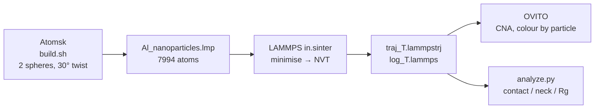

**MD protocol (identical for both runs; only T changes)**

| Step | Setting |
|---|---|
| Units / BC | `metal`, p p p |
| Relaxation | Conjugate-gradient `minimize 1e-8 1e-10 5000 50000` of the freshly cut surfaces |
| Initialisation | `velocity all create T 12345 mom yes rot yes` (same seed for both temperatures) |
| Ensemble | **NVT, Nosé–Hoover** `fix nvt temp T T 0.1` (damping 0.1 ps) |
| Time step | **1 fs** |
| Length | **500 000 steps = 500 ps** (dump every 1 ps → 501 frames) |
| Temperatures | **700 K** and **800 K** |
| Cost | ~6.6 h per run on 4 cores |

**Equilibration protocol (honest note):** minimisation, then direct heating via velocity initialisation and the thermostat. There is no separate equilibration stage. The first ~8 ps before contact serve as equilibration. Measured mean T after 100 ps: 700.3 K and 800.1 K.

**Speaker notes:** Emphasise reproducibility: everything is in the repo (`build.sh`, `in.sinter`, `analyze.py`, `snapshots.py`). A reviewer can re-run with `mpirun -np 6 lmp_mpi -in in.sinter -var T 700`. Note that the initial thermal velocities are identical in distribution at the two temperatures, so differences come from T itself.

---

## Slide 5 — How We Measure Sintering (0:45)

**On-slide content**

Three simple, reproducible observables from the LAMMPS log:

| Observable | Definition |
|---|---|
| **Contact time** | First output frame in which the 4 Å mid-plane slab (centred on the centre of mass) contains ≥ 1 atom |
| **Neck radius x/R** | x = √(N·V_atom / (π·w)), N = atoms in the slab, w = 4 Å, V_atom = a₀³/4. Normalised by R = 25 Å |
| **Neck-formation time** | First frame with **x/R ≥ 0.3** |
| **Radius of gyration Rg** | Falls from 34.3 Å (two separate spheres) toward 24.4 Å (one sphere of equal volume) |
| **Structure** | OVITO common neighbour analysis (CNA): green = fcc, white = surface/defect/boundary |

> **DIAGRAM TO INCLUDE:** Side view of two touching spheres with a thin vertical slab (width w = 4 Å) shaded at the mid-plane. Beside it, a face-on view of the slab as a disc of radius x, with a double-headed arrow labelled "x" and the formula x = √(N·V_atom / (π·w)). Mark R on one sphere to show the normalisation x/R.

```
   ●●●●|●●●●          x = neck radius
  ●●●●●|●●●●●   ⇒     slab of width w at the mid-plane
   ●●●●|●●●●          N atoms in slab → area → x
        ↑
     mid-plane
```

**Speaker notes:** The slab method is an estimate. It assumes a cylindrical neck and gives an effective radius. It is good for comparing the two runs but not an absolute neck radius. Mention this again in limitations.

---

## Slide 6 — Results: Sintering at 700 K (OVITO snapshots) (1:00)

**On-slide content** — four-frame strip, top row = particle-coloured (blue = P1, orange = P2), bottom row = CNA mid-plane slice

| t = 0 ps | t = 10 ps (contact) | t = 15 ps (neck) | t = 500 ps (final) |
|:--:|:--:|:--:|:--:|
|  |  | 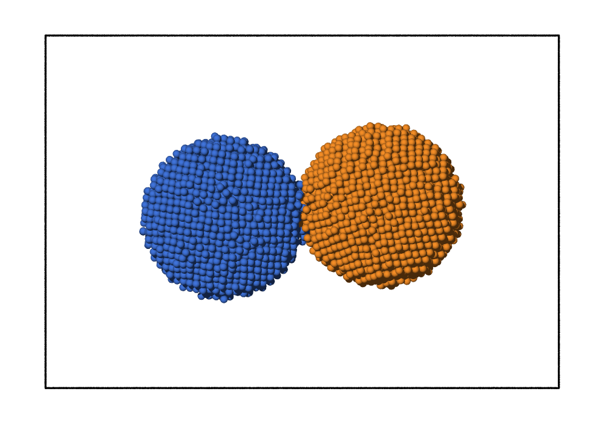 | 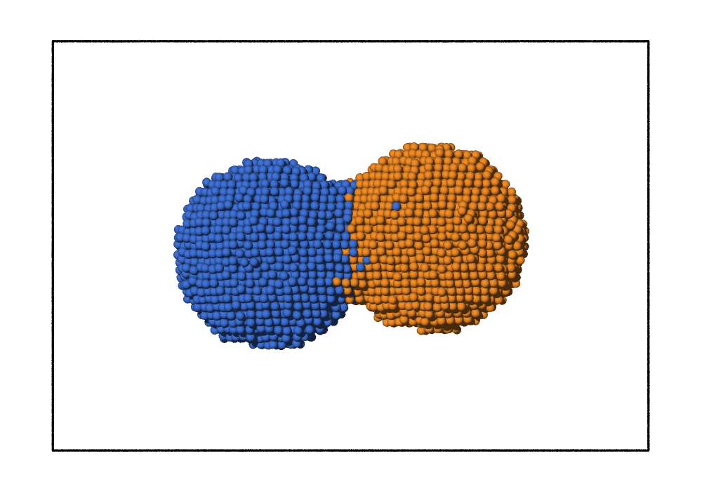 |
| 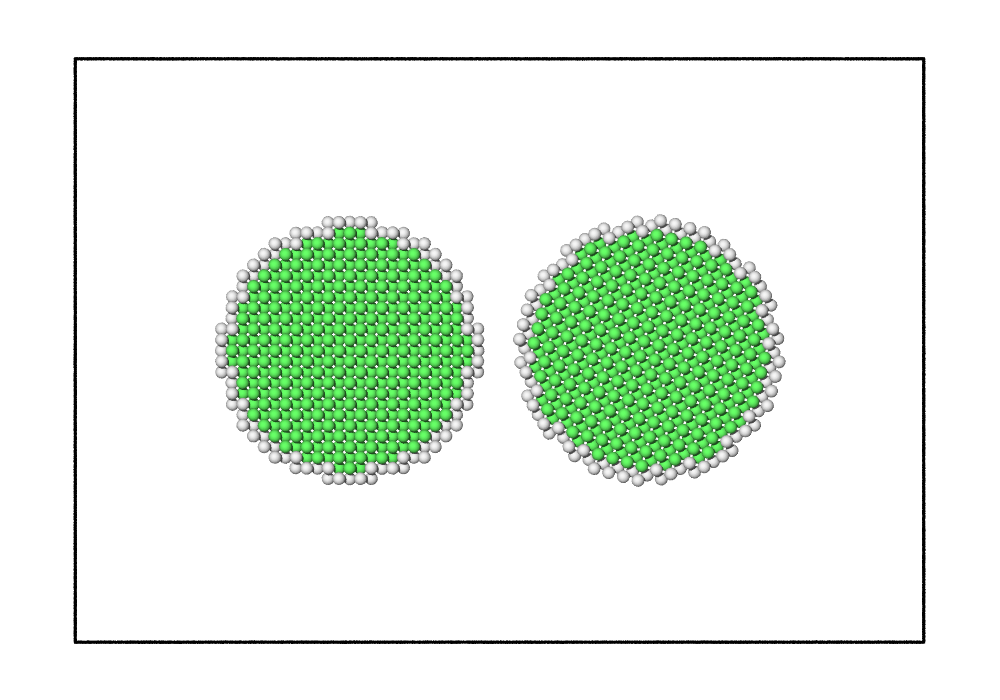 | 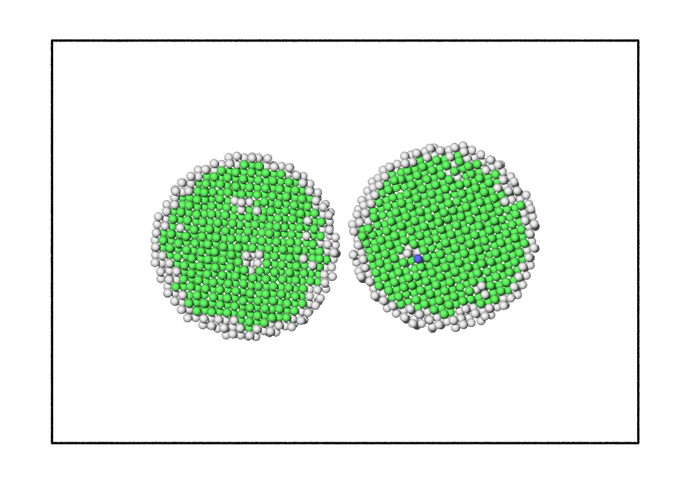 | 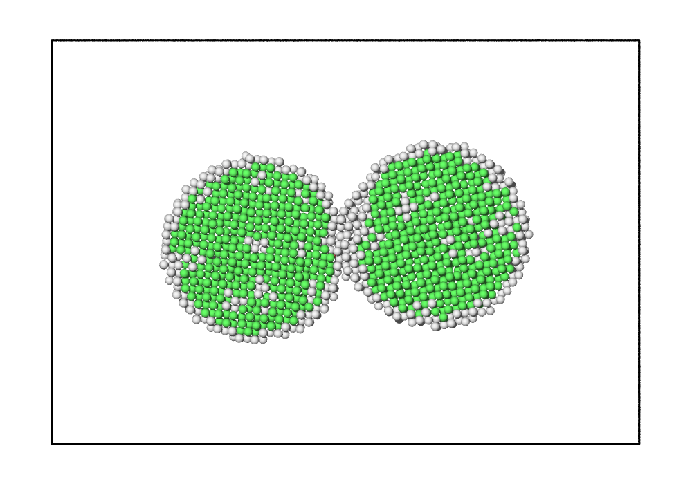 | 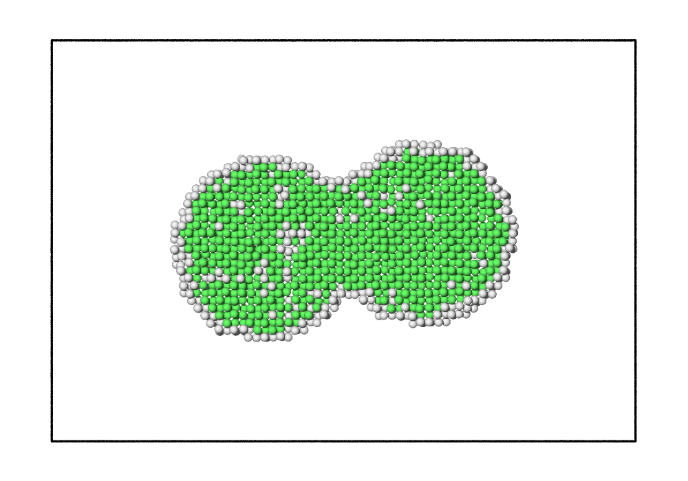 |

**Key observations** (callouts on the slide)
- 0 ps: two separate spheres, 7.6 Å gap
- 10 ps: first atoms bridge the gap (surface atoms jump across). x/R = 0.07
- 15 ps: clear neck, x/R = 0.40, white grain-boundary band visible in CNA
- 500 ps: **dumbbell**, neck x/R = 0.69, crystalline, no melting

**Speaker notes:** Walk left to right: *surface atoms move → contact → neck forms → neck grows*. Point out the white band in the CNA slice at 15 ps: that is the 30° grain boundary. In the final frame, the shape is still a dumbbell and the neck has stopped growing.

---

## Slide 7 — Results: Sintering at 800 K (OVITO snapshots) (1:00)

**On-slide content**

| t = 0 ps | t = 8 ps (contact) | t = 13 ps (neck) | t = 500 ps (final) |
|:--:|:--:|:--:|:--:|
| 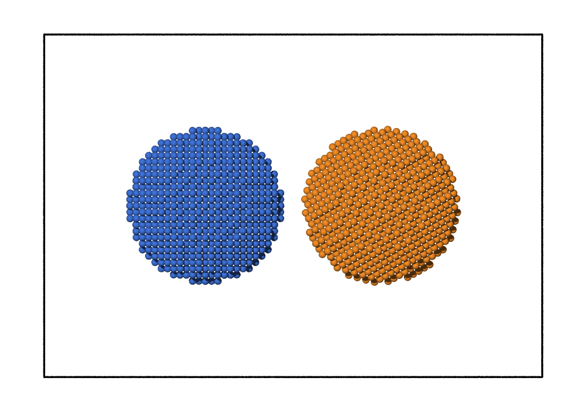 | 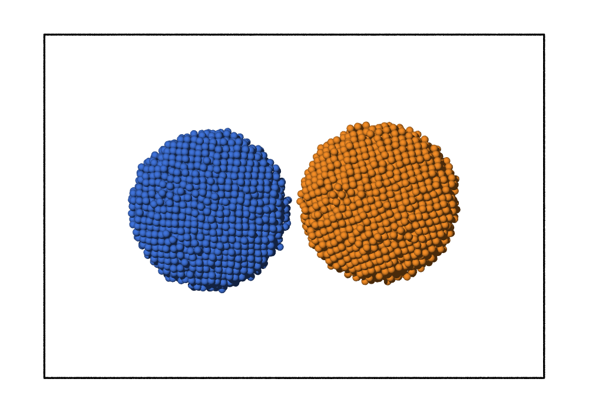 | 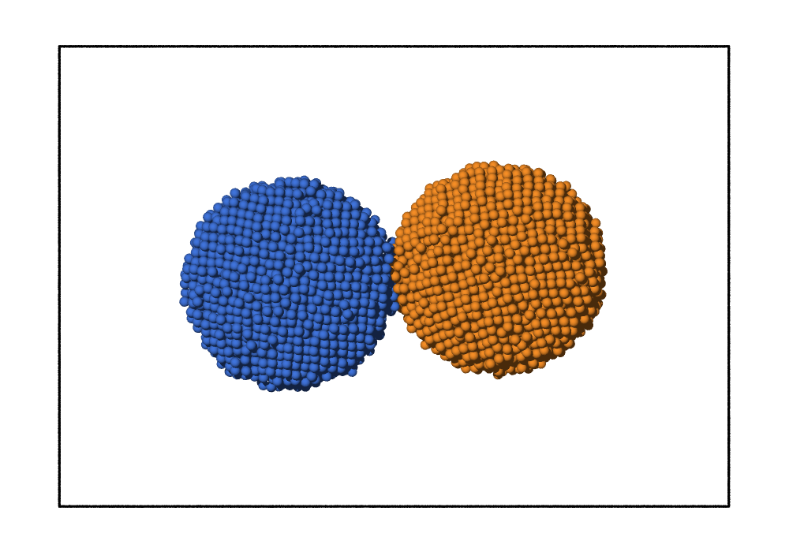 | 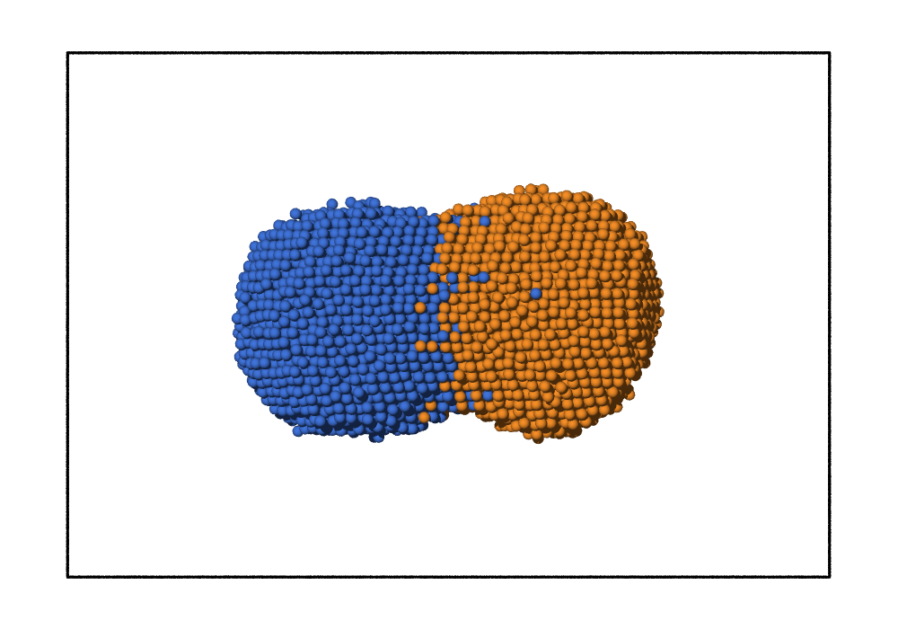 |
|  | 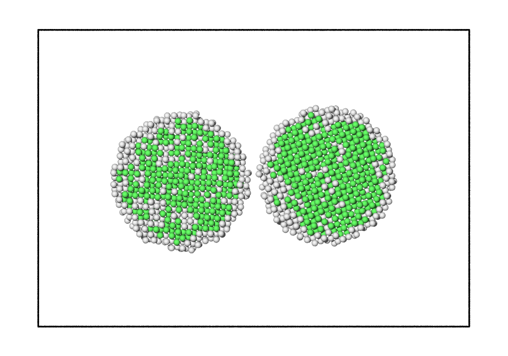 | 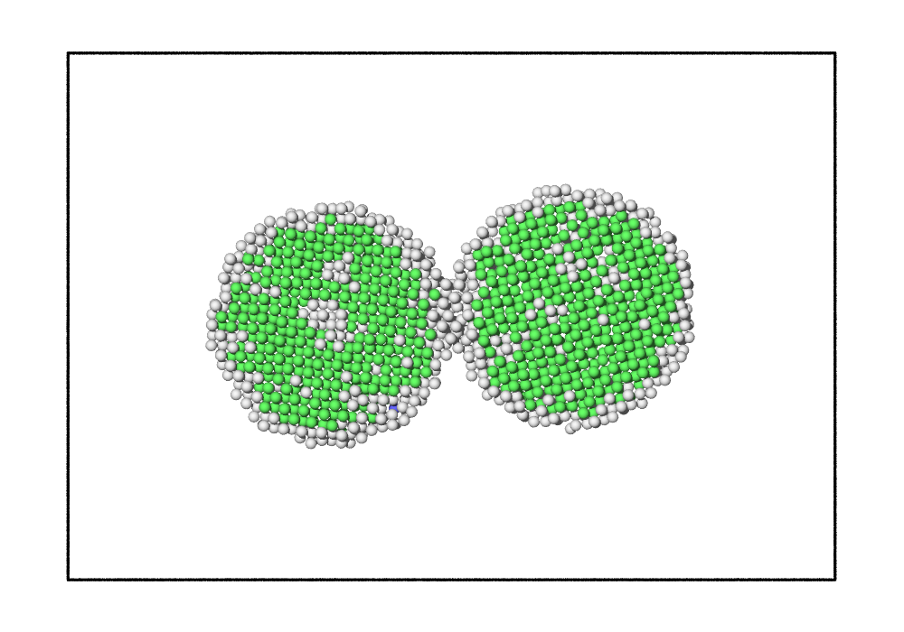 | 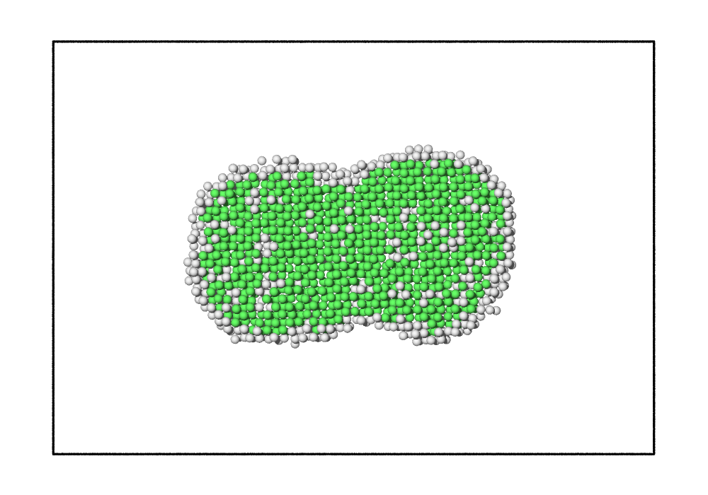 |

**Key observations**
- Contact at 8 ps, neck at 13 ps (2 ps earlier than at 700 K)
- 500 ps: **thicker, shorter, rounder** body, neck x/R = 0.85
- Still fully crystalline; the grain boundary has been removed (see next slides)

*Optional live demo / backup:* `images/gifs/sintering_700K.gif` and `images/gifs/sintering_800K.gif` (side-by-side particle view + CNA slice).

**Speaker notes:** Same sequence, but the late-stage difference is obvious: at 800 K the two lobes have blended much more. Use the table on the next slide to quantify.

---

## Slide 8 — Quantitative Results: Comparison Table (1:00)

**On-slide content**

| Temperature | Contact time | Neck formation (x/R ≥ 0.3) | Time to x/R = 0.6 | Final neck x/R (500 ps) | Final Rg | Final structure |
|:--|:--:|:--:|:--:|:--:|:--:|:--|
| **700 K** | **10 ps** | **15 ps** | 18 ps | 0.69 (plateau after ~20 ps) | 29.5 Å | Dumbbell, fcc fraction 0.65 |
| **800 K** | **8 ps** | **13 ps** | 16 ps | 0.85 (still growing to ~350 ps) | 28.1 Å | Shorter, rounder, fcc fraction 0.59 |

Extra numbers for callouts:
- Time to x/R = 0.7: 800 K → 22 ps; 700 K → **never reached in 500 ps**
- Time to x/R = 0.8 at 800 K: 104 ps
- Potential energy released between contact and 500 ps: ≈ **98 eV (700 K)** vs ≈ **177 eV (800 K)** (includes some thermal noise; one reading from the log)
- Temperature control: mean T over 100–500 ps = 700.3 K and 800.1 K

**Answer to "which sintering is faster?"** → **800 K**, clearly in the late stage and marginally in the early stage.

**Speaker notes:** Be upfront: the early-stage difference (2 ps) is small and from a single trajectory each, so it is within thermal noise. The late-stage difference (0.69 vs 0.85 and plateau vs continued growth) is the robust result.

---

## Slide 9 — Quantitative Results: Neck Growth and Energetics (Plots) (1:10)

**On-slide content** — two charts (data: `output/<T>K/neck_<T>.csv`, `log_<T>.lammps`; sampled values from the real runs).

> **CHART A TO INCLUDE: neck radius x/R vs time.** Line plot from `output/700K/neck_700.csv` and `output/800K/neck_800.csv` (columns `time_ps`, `x_over_R`), 0–500 ps, 700 K in blue and 800 K in orange. Add a dashed horizontal line at x/R = 0.3 (neck criterion) and markers at the contact and neck-formation times. Optionally add an inset zoom of 0–50 ps. The curves should show both rising quickly to ≈ 0.6–0.67 by 20 ps, then 700 K flat at ≈ 0.68 while 800 K keeps climbing to ≈ 0.85.

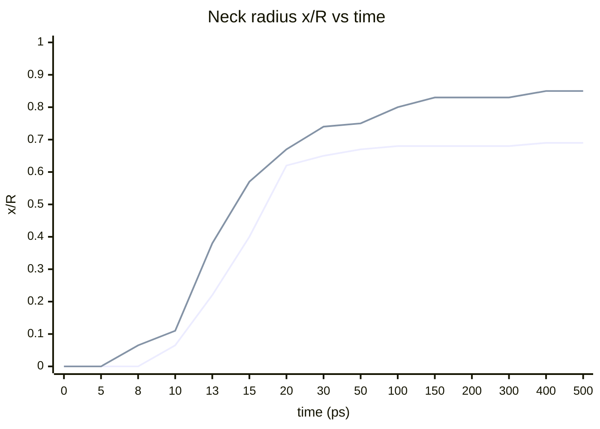

>
> **CHART B TO INCLUDE: radius of gyration Rg vs time.** Same files (`Rg_A` column), same colours. Add a dotted reference line at 24.4 Å (one sphere of the same total volume) and the starting value 34.3 Å (two separate spheres). The curves show Rg falling to ≈ 29.5 Å at 700 K and ≈ 28.1 Å at 800 K.

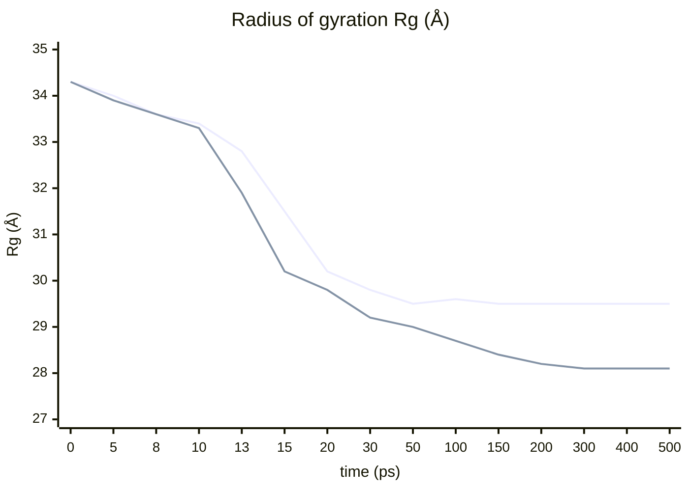

>
> **Optional CHART C: potential energy vs time.** From `PotEng` in the two logs, plotted relative to the pre-contact value, 0–500 ps, both temperatures. It shows the energy released by merging (≈ 100 eV at 700 K and ≈ 180 eV at 800 K).
>
> Export all charts as PNG from Python or Excel, with large axis labels and fonts for the slides.

**Three-stage reading of the curves**
1. **Contact** (≈ 8–10 ps): surface atoms bridge the gap
2. **Rapid neck formation** (to ≈ 20 ps): x/R jumps from 0 to ≈ 0.6–0.67. Driven by the large energy gain of removing two surfaces and by fast local atomic rearrangement
3. **Slow growth / saturation:** at **700 K** x/R plateaus at ≈ 0.68; at **800 K** it keeps climbing through 100–350 ps to ≈ 0.85

**Speaker notes:** The point of this slide is the *divergence after ~20 ps*. Both runs have a fast initial stage; only 800 K has enough atomic mobility to continue. This is a transition from a fast, local, low-barrier stage to a slower, diffusion-limited stage.

---

## Slide 10 — Physical Mechanism: Grain Boundary, Rotation and Where the Neck Atoms Come From (1:00)

**On-slide content**

**What we saw in OVITO**
- The 30° misorientation produces a **grain-boundary band** in the neck (white in CNA) at contact/neck formation
- The particles then **rotate into alignment** (misorientation about z falls to ≈ 1°): ≈ **50 ps at 700 K**, ≈ **200 ps at 800 K**. By 500 ps the neck is single-crystal fcc at both temperatures
- Colouring by initial particle shows the neck atoms come from **both** particles, mostly via **surface atoms** near the contact. There is also some local rearrangement at the boundary
- No melting: fcc fraction 0.5–0.65 throughout, and particles stay faceted/crystalline (the "non-fcc" fraction is mostly surface atoms: about a third of the atoms in a 4000-atom sphere)

**Mechanism schematic**

> **DIAGRAM TO INCLUDE:** Cross-section sketch of the neck region with arrows. Show (1) surface atoms on the convex particle surfaces, (2) arrows along the surface toward the concave neck, labelled "surface diffusion, driven by lower chemical potential (Gibbs–Thomson)", and (3) the grain-boundary line at the neck labelled "30° boundary → particles rotate → single crystal". Below it, a four-step strip: *under-coordinated surface atoms → contact → neck filled by surface diffusion → boundary removed by rotation*.

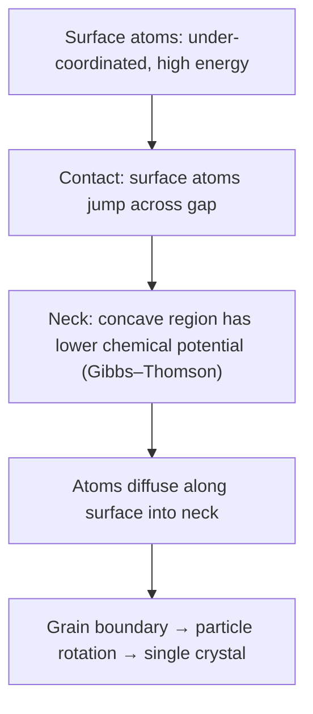

**Speaker notes:** This ties the OVITO pictures to textbook sintering: surface diffusion feeds the neck, and misoriented particles can reorient to remove the boundary. Note the rotation took longer at 800 K in our run. Do not over-interpret: one run each, and the rotation depends on the particular boundary structure that formed.

---

## Slide 11 — Comparison with Literature (1:30)

**On-slide content**

| # | Our result | Published work | Agreement |
|---|---|---|---|
| 1 | Higher T → faster / larger neck; strongest effect in the late stage | Jiang, Chen & Sun, *J. Mater. Sci. Technol.* **57**, 92 (2020): Al nanoparticles (≈ 4–10 nm), radius ratio (neck/particle), shrinkage and displacement rise with temperature, in **three stages** (slow rise → abrupt rise at the sintering temperature → plateau → sharp rise at melting). Liu et al., *Comput. Mater. Sci.* (2021): reactive-MD of bare/coated Al, also **three stages**; smaller particles sinter sooner. | ✔ **Qualitative.** Same trend. Our 700–800 K window lies in the plateau regime (below melting), consistent with their middle stage |
| 2 | Fast first stage (~20 ps), then plateau (700 K) vs slow continued growth (800 K) | Lewis, Jensen & Barrat, *Phys. Rev. B* **56**, 2248 (1997): Au nanoclusters (EAM). Coalescence takes **much longer** than macroscopic sintering theory predicts, because clusters are faceted rather than smooth | ✔ **Qualitative.** Stalled/slow late-stage growth is consistent with faceted particles. Classical theory is not expected to hold quantitatively here |
| 3 | 30° misoriented particles rotate to align (≈ 1° residual) | Zhu & Averback, *Philos. Mag. Lett.* **73**, 27 (1996): Cu nanoparticle pair (MD). Misaligned particles **rotate (~17° reported) to form a low-energy boundary**; aligned particles become one fcc crystal by dislocation glide | ✔ **Qualitative.** Particle rotation is the same mechanism. Their final misorientation (low-energy boundary) differs from our near-zero, probably because of different material, size and symmetry. Our system ends essentially single crystal |
| 4 | Crystal orientation has a limited effect on neck growth | Jiang et al. (2020): particle orientation has **limited influence** on neck growth | ◐ **Not tested directly.** We used one misorientation only. Consistent but unverified |
| 5 | No melting at 700–800 K for R = 2.5 nm | Bulk Tm of this EAM ≈ 1041 K vs. experiment 933 K (arXiv:2412.16294, interface-velocity method). Al nanoparticle melting temperature falls with size (Gibbs–Thomson, linear in 1/R; Alavi & Thompson, *J. Phys. Chem. A* **110**, 1518 (2006); other MD studies report ~470 K at 2 nm → ~940 K bulk, but with *different* potentials) | ◐ **Plausible.** Our fcc fraction stays high. Surface pre-melting is not excluded. Size-dependent Tm for this exact potential was not verified |
| 6 | Time scales: contact ≈ 10 ps, neck ≈ 15 ps | MD sintering studies generally report neck formation within **tens to hundreds of ps** at similar T/T_m (Zhu & Averback; Lewis et al.; Ag studies, Alarifi et al., *Mater. Trans.* **54**, 884 (2013)) | ◐ **Order-of-magnitude.** Our times depend strongly on the initial gap (see Discussion). No direct numerical comparison is possible: different material, size, gap, T/T_m |

**Honest summary:** *Trends agree with the literature; numbers are not directly comparable* (different potentials, particle sizes, gaps and neck definitions). We did not find a published value for exactly this geometry (Al, R = 2.5 nm, Mishin EAM, 700/800 K), so we do not claim quantitative agreement.

**Speaker notes:** Be careful to say "trends" not "quantitative agreement". Lead with rows 1 and 3, as they are the clearest. Row 5 is a plausibility argument, not a verification. If asked, say we compared against abstracts and key results; the quantitative values from the Jiang and Zhu papers should be checked against the full texts before the talk (see the checklist at the end of this file).

---

## Slide 12 — Discussion and Limitations (1:10)

**On-slide content**

| Assumption / limitation | Effect on conclusions |
|---|---|
| **Single run per temperature** (one seed, 12345) | The 2 ps difference in contact/neck time is **within noise**. The late-stage plateau difference is large but should be confirmed with ≥ 3 seeds and error bars |
| **Initial gap 7.6 Å > cutoff 6.29 Å** | Contact needs thermal motion, so contact time depends on the gap. An earlier test with a 4 Å gap gave contact in **1–4 ps at both T with no temperature effect** |
| **Only two temperatures** | Cannot extract an activation energy (needs ≥ 4–5 temperatures, Arrhenius plot) |
| **Neck metric** (slab, cylinder assumption) | Gives an effective radius; absolute values uncertain by ~10–20 %, but the comparison between runs is consistent |
| **NVT thermostat on the whole system** | Neglects release of heat: the energy gain (~100–180 eV) is removed by the thermostat. Real nanoparticles heat locally |
| **Small particles (R = 2.5 nm), one potential** | EAM potential fitted to bulk, not validated for surface diffusion on nanoparticles. Predicted Tm is ≈ 1041 K vs 933 K experimental, so **T/Tm differs from reality** (700–800 K is ≈ 0.67–0.77 Tm of this model; ≈ 0.75–0.86 of the experimental Tm) |
| **Special 30° misorientation, one geometry** | The boundary and rotation behaviour may differ for other misorientations. Not generalisable |
| **500 ps total** | The 800 K neck was still growing at the end (x/R = 0.85). The true equilibrium shape is not reached |
| **No oxide shell, no surface contamination** | Real Al nanoparticles carry a ~2–4 nm Al₂O₃ shell that strongly hinders sintering |

**Timing:** Production runs are expensive (~6.6 h each), which is why there is no ensemble yet.

**Speaker notes:** Acknowledge the single-run limitation first; the instructors will look for honesty here. If asked "is the temperature effect real?": the late-stage trend is large (Δx/R = 0.16) and consistent with the literature, but the early-stage 2 ps is not significant.

---

## Slide 13 — Conclusions (Answers to the Project Questions) (1:00)

**On-slide content**

1. **Why do the particles join?** Surface atoms are under-coordinated. Merging removes surface area, so total energy falls (PE drops ≈ 100–180 eV)
2. **Why does a neck form?** The contact region is concave. By the Gibbs–Thomson relation its chemical potential is lower than on the convex surfaces, so atoms flow into it
3. **Why does a higher T accelerate it?** Atomic motion is thermally activated (D = D₀ exp(−Q/kT)). 800 K gives more surface-atom hops per second, and larger vibrations help bridge the gap
4. **Where do the neck atoms come from?** Mainly surface atoms near the contact on **both** particles (two-colour neck in OVITO), plus local rearrangement at the new grain boundary
5. **Why does it matter for nanoparticles?** Huge surface-to-volume ratio means a large driving force. Diffusion distances are tiny, and Herring scaling (t ∝ R⁴ for surface diffusion) makes small particles sinter much faster

**Headline results**

| | 700 K | 800 K |
|---|---|---|
| Contact / neck | 10 / 15 ps | 8 / 13 ps |
| Final x/R | 0.69, plateau | 0.85, still growing |
| Outcome | Dumbbell | Rounder, thicker neck |

**800 K sinters faster; the effect is modest at first contact and large in the later stages. Both runs stay crystalline (no melting), and the 30° boundary is removed by particle rotation.**

**Speaker notes:** Answer the five questions of the project sheet one-by-one, with one sentence each, then show the table. Close on the limitation: the trend is robust, the numbers are single-run.

---

## Slide 14 — References (not timed)

**On-slide content**

**Potential and tools**
1. Y. Mishin, D. Farkas, M. J. Mehl, D. A. Papaconstantopoulos, "Interatomic potentials for monoatomic metals from experimental data and ab initio calculations," *Phys. Rev. B* **59**, 3393–3407 (1999). DOI: 10.1103/PhysRevB.59.3393. File `Al99.eam.alloy`, NIST Interatomic Potentials Repository (https://www.ctcms.nist.gov/potentials/entry/1999--Mishin-Y-Farkas-D-Mehl-M-J-Papaconstantopoulos-D-A--Al)
2. P. Hirel, "Atomsk: A tool for manipulating and converting atomic data files," *Comput. Phys. Commun.* **197**, 212–219 (2015)
3. A. P. Thompson et al., "LAMMPS: a flexible simulation tool for particle-based materials modeling at the atomic, meso, and continuum scales," *Comput. Phys. Commun.* **271**, 108171 (2022)
4. A. Stukowski, "Visualization and analysis of atomistic simulation data with OVITO," *Modelling Simul. Mater. Sci. Eng.* **18**, 015012 (2010)

**Literature used for comparison**
5. S. Zhu and R. S. Averback, "Sintering processes of two nanoparticles: A study by molecular dynamics simulations," *Philos. Mag. Lett.* **73**, 27–33 (1996). DOI: 10.1080/095008396181073
6. L. J. Lewis, P. Jensen, J.-L. Barrat, "Melting, freezing, and coalescence of gold nanoclusters," *Phys. Rev. B* **56**, 2248–2257 (1997). DOI: 10.1103/PhysRevB.56.2248 (arXiv:cond-mat/9703153)
7. Y. Jiang, Y. Chen, Y. Sun et al., "Monitoring micro-structural evolution during aluminum sintering and understanding the sintering mechanism of aluminum nanoparticles: A molecular dynamics study," *J. Mater. Sci. Technol.* **57**, 92–100 (2020). DOI: 10.1016/j.jmst.2020.03.068 *(author list/initials to be checked against the paper)*
8. Liu et al., reactive-MD study of sintering of bare and ethanol-coated Al nanoparticles, *Comput. Mater. Sci.* (2021) *(full citation to be checked)*
9. S. Alavi and D. L. Thompson, "Molecular dynamics simulations of the melting of aluminum nanoparticles," *J. Phys. Chem. A* **110**, 1518–1523 (2006). DOI: 10.1021/jp053318s
10. M. Alarifi, et al., "Molecular dynamics simulation of sintering and surface premelting of silver nanoparticles," *Mater. Trans.* **54**, 884–889 (2013) *(author list to be checked)*
11. C. Herring, "Effect of change of scale on sintering phenomena," *J. Appl. Phys.* **21**, 301–303 (1950) *(from memory; standard citation for the scaling law)*
12. EAM reference melting temperature for Mishin Al: "Machine-learnt potential highlights melting and freezing of aluminium nanoparticles," arXiv:2412.16294 (2024)

**Course material:** S. Mukherjee, MT41028 Project 7 handout (v2.0, Aug 2026).

---

# Backup Slides (for Q&A)

## Backup B1 — Structure check and input files

- `structure/Al_nanoparticles.lmp`: 7994 atoms, box 0–160 × 0–110 × 0–110 Å, 1 atom type, mass 26.98 amu
- Atomsk commands (from `build.sh`):
  ```
  atomsk --create fcc 4.05 Al -duplicate 14 14 14 \
         -select out sphere 0.5*box 0.5*box 0.5*box 25.0 -rmatom select np1.xsf
  atomsk np1.xsf -select all -rotate com z 30 -shift 56.5 0 0 np2.xsf
  atomsk --merge 2 np1.xsf np2.xsf Al_nanoparticles.lmp \
         -cell H1 set 160 -cell H2 set 110 -cell H3 set 110 -center com
  ```
- Minimisation: PE from −25818.2 eV to −25828.9 eV (surface relaxation, ≈ 10.7 eV)
- Image: `images/700K/snap_700_0ps.png`

## Backup B2 — Why the gap matters (contact-time sensitivity)

- Current gap 7.6 Å (beyond the 6.29 Å cutoff) → contact via thermal motion: 10 ps (700 K), 8 ps (800 K)
- Earlier test with a 4 Å gap (inside the cutoff, so attraction acts): contact in 1–4 ps at both T, no T dependence
- Conclusion: contact time mostly reflects initial conditions and should not be over-interpreted. Neck *growth* is the more physical probe of temperature

## Backup B3 — Arrhenius expectation (illustrative, no fit)

For thermally activated transport, the rate ratio between 800 K and 700 K is exp[(Q/k_B)(1/700 − 1/800)] ≈ exp(2.07·Q[eV]):

| Assumed Q | Expected 800 K / 700 K rate ratio |
|---|---|
| 0.3 eV | 1.9× |
| 0.5 eV | 2.8× |
| 1.0 eV | 7.9× |

The early-stage speed-up we see (neck time 15 → 13 ps, ≈ 1.15×) would imply a very small Q, but is not statistically meaningful. The late-stage difference (plateau vs. continuing growth) is more consistent with a higher barrier. A proper estimate needs ≥ 4–5 temperatures and several seeds. *(These Q values are illustrative assumptions, not literature values.)*

## Backup B4 — Herring scaling law and why nanoparticles sinter so readily

- Herring: for geometrically similar particles, t₂/t₁ = (R₂/R₁)ⁿ, with n = 4 for surface diffusion, 3 for lattice diffusion, 4 for grain-boundary diffusion, 2 for vapour transport
- Neck growth (surface diffusion): xⁿ ∝ t with n ≈ 7 in classic models; with x/R fixed this gives t ∝ R⁴
- Going from R = 5 µm to 2.5 nm (2000×): t would be shorter by 2000⁴ ≈ 10¹³ (in this idealisation)
- Lewis et al. caution that macroscopic laws overestimate the speed for faceted clusters, so this is an upper bound

---

# Delivery Plan

## Timing (target 11:00)

| Slides | Topic | Time | Suggested speaker |
|---|---|---|---|
| 1–2 | Title, motivation | 1:10 | [[Member A]] |
| 3–5 | Model, potential, protocol, metrics | 3:35 | [[Member B]] |
| 6–9 | Results (snapshots, table, plots) | 4:10 | [[Member C]] |
| 10–11 | Mechanism and literature | 2:30 | [[Member D]] |
| 12–13 | Limitations and conclusions | 2:10 | [[Member A / B]] |

(Sums to ≈ 13 min as listed, so **cut to fit 11 min**: merge slides 3 and 4 into one at delivery, show only the 700 K and 800 K strips on one slide, and shorten the notes on slides 5, 10 and 12. Rehearse with a timer.)

## Check before submission

- [ ] Fill in group number, names and speaker split
- [ ] Verify against the full paper text: Jiang et al. 2020 (authors, numeric neck ratios, temperature ranges), Liu et al. 2021 (full citation), Alarifi et al. 2013 (authors, journal details), Zhu & Averback (17° value and neck/time scales)
- [ ] Verify Mishin-EAM bulk Tm ≈ 1041 K from the primary source (arXiv:2412.16294 or a LAMMPS melting run); drop the number if unverified
- [ ] Confirm "98 / 177 eV" PE-drop numbers from the logs, since they are quoted from the log at contact and 500 ps and include thermal fluctuation
- [ ] Build the final figures for slides 2, 3, 4, 5, 9, 10 from the **DIAGRAM / CHART TO INCLUDE** notes. The Mermaid and ASCII drafts under each note are rough placeholders. If Mermaid doesn't render when exporting to PDF, recreate the charts from the CSVs in matplotlib or Excel.
- [ ] Export final deck to PDF, name `Group##_MT41028_Project.pdf`, upload by 17:00 on 06 Nov 2026. Keep a local backup
- [ ] Run a 10–11 minute rehearsal. Every member should be ready for Q&A on the whole project

## Likely Q&A questions (short prepared answers)

1. *Is the temperature effect statistically significant?* Early-stage no (single run, 2 ps). Late-stage trend is large, but needs more seeds.
2. *Why only 700 and 800 K?* Project spec. Each run costs ≈ 6.6 h.
3. *Did the particles melt?* No: fcc fraction 0.5–0.65 throughout (CNA), mostly surface atoms.
4. *Why 30° misorientation?* To see grain-boundary formation and rotation, which is the realistic case for random powders.
5. *What mechanism dominates?* Surface diffusion and local rearrangement in the early stage; rotation/reorientation at the boundary later. We did not separate contributions quantitatively.
6. *Is the potential valid for nanoparticles?* Fitted to bulk and ab initio data, including surface energies, but not tested on small clusters by us.
